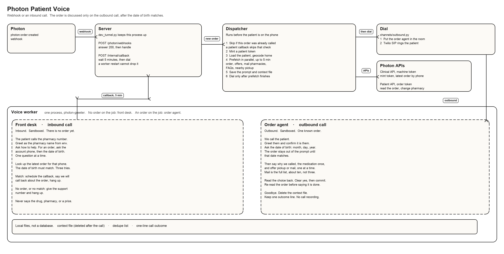
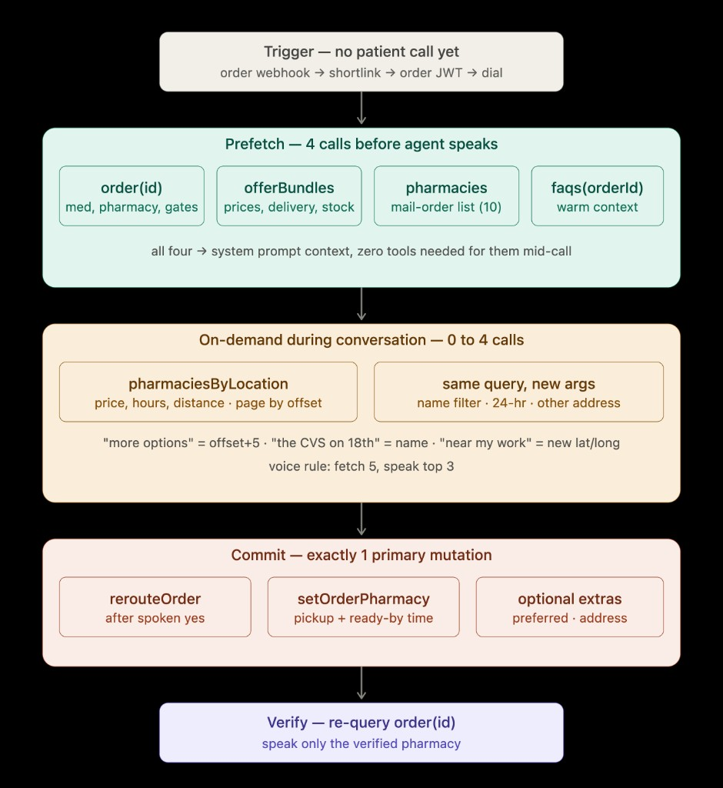

# Photon Voice Accessibility — Python

A voice agent for Photon (Neutron) pharmacy patients. It reaches a patient by
phone and walks them through where their prescription is going; if the order can
still change, it moves it to a pharmacy they pick. There are two ways in:

- **Outbound** — a `photon:order:created` webhook triggers a call about that order.
- **Inbound** — a patient calls the pharmacy number; a front-desk agent verifies
  them and schedules an outbound callback about their latest order.

The order is only ever discussed on the **outbound** call, and only **after the
date of birth matches** — the order details stay out of the model's prompt until
then.

## How it fits together

**Call flow — inbound and outbound share one worker:**


**System architecture — webhook, server, dispatcher, voice worker:**



**GraphQL / tool-call map — what runs before vs. during the call:**



## Flow in words

```
photon:order:created webhook
  -> mint an order-scoped patient JWT (from M2M client credentials)
  -> fetch patient (name, phone, DOB, address) -> geocode address
  -> prefetch in parallel: order, offers, mail-order pharmacies, FAQs, nearby
  -> shape promptBlock (spoken words, no ids) + seed (ids, prices, lat/lng)
  -> write context/<orderId>.json
  -> dial (room metadata = {orderId, patientJwt} only)
order agent joins
  -> verify DOB -> order details enter the prompt -> options -> read back
  -> commit (reroute / setOrderPharmacy) -> re-verify -> goodbye

inbound call (no order on the job)
  -> front desk greets as the pharmacy -> asks account phone + DOB
  -> orders(filter:{patientPhone}, newest first) -> DOB must match
  -> POST /internal/callback -> server waits CALLBACK_DELAY_S -> outbound flow
```

## Layout

```
Python/
  dispatcher.py             order:created -> prefetch -> dial
  server.py                 aiohttp webhook server + /internal/callback
  prompts/voice_persona.txt the fixed persona
  docs/                     the three diagrams above
  conftest.py               puts src/ on the path for pytest
  src/
    shared/config.py        single env reader
    shared/context_store.py context/<orderId>.json read/write
    photon/                  ALL Neutron network I/O (client, queries, prefetch,
                             geocode, actions, patient, events, dedupe, webhook_admin)
    auth/                    M2M token + per-order patient JWT
    channels/outbound.py     dispatch agent into room, then SIP dial
    voice/
      shape_context.py       prefetch -> promptBlock + seed; sanitize_for_voice
      session_state.py       SessionState + resolve("option two" -> id)
      spoken_time.py         "tomorrow after four" -> datetime
      tools.py               the agent tools
      agents/order_agent.py  persona + promptBlock + tools (context gated on DOB)
      inbound.py             front-desk agent + callback scheduling
      session_factory.py     STT -> LLM -> TTS, pre-TTS normalizer, expressive mode
      entry.py               LiveKit worker (branches: order vs. inbound)
  tests/                     unit tests (pure logic)
```

## Tools

| Tool | When | What it does |
|---|---|---|
| `verify_identity` | always | compares spoken DOB server-side; DOB never enters the prompt; reveals the order context on success |
| `search_nearby` | always | new area / name / 24h / "more" (pages from cached lat/lng) |
| `end_call` | always | handoff line with support number, then hangs up |
| `choose_pharmacy` | order reroutable | `rerouteOrder`, then re-reads the order to verify |
| `set_pickup_time` | order reroutable | `setOrderPharmacy` with parsed day/time, then verifies |
| `save_preferred_pharmacy` | order reroutable | `setPreferredPharmacy` |
| `request_callback` | inbound only | find latest order by phone, verify DOB, schedule the callback |

Write tools are **not registered** when the order can't change, so the model
can't call what it doesn't have. They also refuse until identity is verified and
until `confirmed=true` (sent only after a spoken read-back and a clear yes).

## Design decisions

- **Direct LiveKit function tools**, not a nested agent framework — one model
  loop keeps latency low on a phone call. Pydantic only validates Photon I/O.
- **PHI never leaks early**: the order block is withheld from the prompt until
  `verify_identity` passes. The powerful org-wide M2M token never enters room or
  agent metadata — only the single-order patient JWT does.
- **Inbound reuses outbound**: the front desk authenticates and hands off to the
  same dispatcher via a delayed callback; the conversation logic lives in one place.
- **Stateless-ish**: the context file is deleted after the call; only a one-line
  outcome is kept. No call recording (`record=False`).

## Run it locally

Everything runs from this `Python/` folder with `src/` on the path.

**1. Install**
```bash
pip install -r requirements.txt
```

**2. Configure** — copy `.env.example` to `.env` and fill it in (Photon client
id/secret, LiveKit url/key/secret, SIP trunk id, caller number).

**3. Unit tests**
```bash
python -m pytest -q
```

**4. Agent worker** (terminal 1)
```bash
PYTHONPATH=src python -m voice.entry dev
```

**5. Webhook server** (terminal 2)
```bash
PYTHONPATH=src python server.py
```
For a public URL locally, put `ngrok http 3000` in front and register the
`<public>/photon/webhooks` URL in Neutron. In production, Railway gives you the
public URL (below) — no ngrok needed.

**6. Trigger** — create a fresh, still-reroutable order in the Neutron app.

**Console (no phone):** needs an existing `context/<orderId>.json`.
```bash
DRY_RUN=1 CONSOLE_ORDER_ID=<orderId> PYTHONPATH=src python -m voice.entry console
```

## Deploy on Railway — two services, one repo

Point Railway at this `Python/` folder. Create **two services** from the same code:

| Service | Start command | Public? | Purpose |
|---|---|---|---|
| **web** | `PYTHONPATH=src python server.py` | **yes** | its domain `+ /photon/webhooks` is the URL you give Neutron; also serves `/internal/callback` |
| **worker** | `PYTHONPATH=src python -m voice.entry start` | no | joins LiveKit rooms and runs the calls (dials out, no inbound port) |

Set the same environment variables on both. Give Neutron the **web** service's
`https://<web-domain>/photon/webhooks`. That's the only URL they need.

## Notes

- `TEST_PHONE_OVERRIDE` blank = the **real patient phone** is dialed.
- `context/`, `state/`, `calls.jsonl`, `webhooks.jsonl`, `.env` hold PHI/secrets
  and are gitignored — never pushed.
- Signature verification is log-only (`src/photon/events.py`).
- TTS is Fish S2.1 Pro via LiveKit Inference (no Fish key); swap `TTS_MODEL` /
  `TTS_VOICE` to change the voice.
